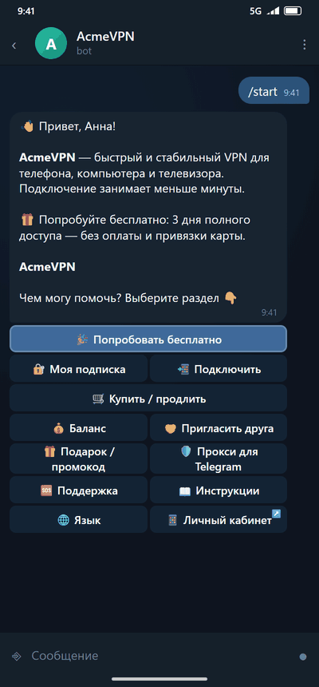
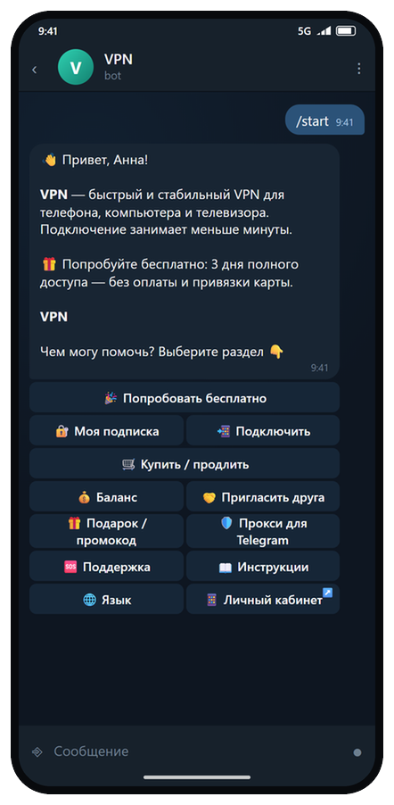
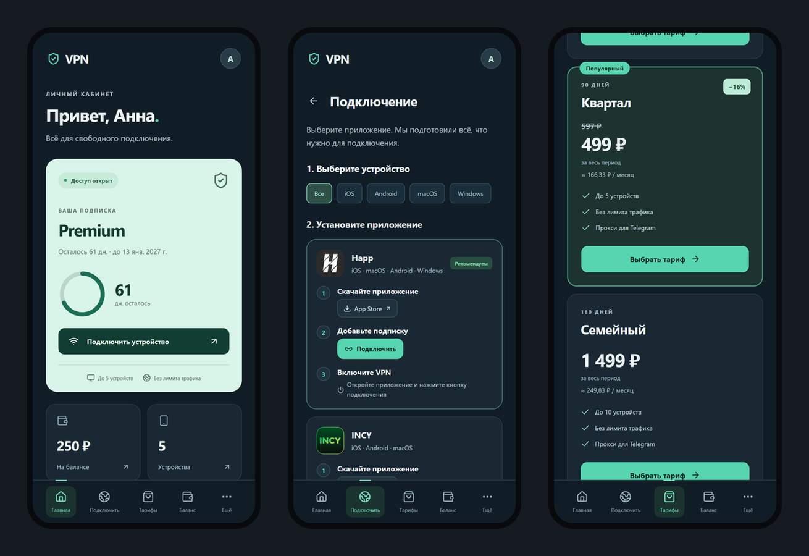
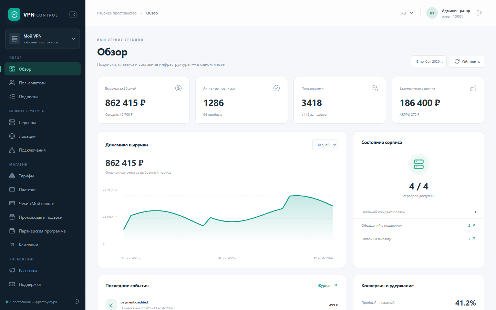
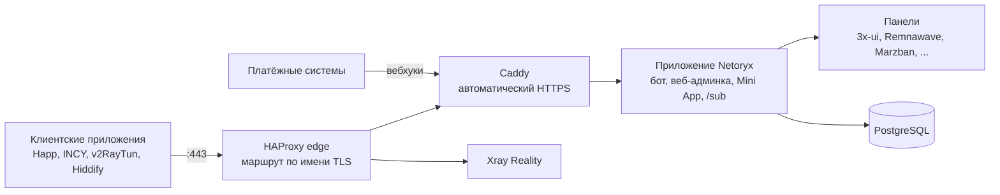

<p align="center">
  <picture>
    <source media="(prefers-color-scheme: dark)" srcset="docs/images/logo-on-dark.png">
    <source media="(prefers-color-scheme: light)" srcset="docs/images/logo-on-light.png">
    
  </picture>
</p>

<p align="center"><b>Свой VPN-сервис в Telegram-боте.</b><br>На вашем сервере · 6 панелей · 28 способов оплаты · стабильная работа в сетях с ограничениями</p>

<p align="center">
  <a href="https://github.com/qklafk/netoryx/releases"></a>
  <a href="LICENSE"></a>
  <a href="https://github.com/qklafk/netoryx/actions/workflows/ci.yml"></a>
  <a href="https://github.com/qklafk/netoryx/pkgs/container/netoryx"></a>
  <a href="https://github.com/qklafk/netoryx/stargazers"></a>
</p>

<p align="center">
  <b>Русский</b> | <a href="README.en.md">English</a>
</p>

<p align="center">
  <a href="#быстрый-старт">Быстрый старт</a> ·
  <a href="#документация">Документация</a> ·
  <a href="https://t.me/netoryx">Telegram-канал</a> ·
  <a href="https://qklafk.github.io/netoryx/">Сайт</a>
</p>

<p align="center"></p>

**Netoryx** это self-hosted Telegram-бот, веб-админка и Mini App для продажи или раздачи доступа к VPN.

- **Работает с панелями, которые у вас уже есть:** 3x-ui, Remnawave, Marzban, Marzneshin, PasarGuard, Hiddify, в любом сочетании.
- **Продаёт за вас:** 28 способов оплаты, тарифы, пробный период, автопродление, рефералы, одна личная ссылка подписки на клиента.
- **Ставится одной командой** на чистый Linux-сервер; подходит и для себя, семьи и друзей (личный режим, без платежей).

> **Статус: 0.9.0-beta.** Первая публичная бета. Проект работает на реальном сервере, но наработки в бою у него пока
> меньше, чем у старых проектов. Перед обновлением делайте резервную копию, о странностях пишите в Issues.

## Быстрый старт

На чистом сервере от имени root:

```bash
curl -fsSL https://raw.githubusercontent.com/qklafk/netoryx/main/install.sh | sudo bash
```

Установщик спросит токен бота (его выдаёт [@BotFather](https://t.me/BotFather)) и ваш Telegram ID. Без вопросов:

```bash
sudo bash install.sh --bot-token <токен> --admin-id <ваш telegram id> --domain vpn.example.com --with-xui --yes
```

Без `--domain` берётся `<ip-через-дефисы>.sslip.io`: настоящий HTTPS-сертификат без настройки DNS (первый сертификат
может выпускаться минуту-две). Необязательные флаги: `--with-xui` (поставить панель 3x-ui рядом с ботом),
Устаревшие `--with-tgproxy` и `--with-socks` (прокси для Telegram; в некоторых странах не работают) больше не
предлагаются.

**Что вы получите в конце:**

- одноразовую ссылку в веб-админку;
- имя бота и домен подписок;
- общую ссылку «только Telegram» (её можно публиковать): адрес страницы `/tg` и ссылку подписки для Happ / v2RayTun
  с QR-кодом в терминале (через VPN идёт только Telegram, остальное напрямую; любая панель, кроме Hiddify);
- всё в `/opt/netoryx`, управление командой `netoryx`:
  `netoryx status | logs [сервис] | update | backup [--full] | restore | admin-link | tg-link | restart | uninstall`;
  `netoryx backup --full` сохраняет весь сервер одним архивом, а `netoryx restore` переносит его на новый
  ([резервные копии](docs/ru/backups.md)).

| Система | x86_64 | ARM64 | Статус |
|---|---|---|---|
| Ubuntu 24.04 | да | да | проверена на реальном сервере |
| Ubuntu 22.04, 26.04 | да | да | бета |
| Debian 12, 13 | да | да | бета |
| AlmaLinux 9, Rocky Linux 9 | да | да | бета |

Минимум: root-доступ, 2 vCPU / 2 ГБ ОЗУ / 20 ГБ диска, токен бота, открытые порты 80 и 443 (ещё один только при
включённом SOCKS5). Домен желателен; без него используется `sslip.io`. Подробности, флаги и список изменений на
сервере: [docs/ru/installation.md](docs/ru/installation.md).

## Возможности

<table>
<tr>
<td width="33%" valign="top">

**🧩 Панели**<br>
3x-ui (2.x и 3.x), Remnawave 3.0+, Marzban, Marzneshin, PasarGuard, Hiddify, сколько угодно одновременно. Импорт
существующих пользователей, оповещения о здоровье. [Документация](docs/ru/panels.md)

</td>
<td width="33%" valign="top">

**💳 Платежи, 28 способов**<br>
Stars, 6 криптовариантов (CryptoBot, Heleket, NOWPayments, Plisio, прямые TON и USDT TRC-20), 17 российских шлюзов (включая RollyPay, cisPay, TabPay),
Stripe, PayPal, ручной перевод по карте/СБП, универсальный HTTP-шлюз. Зачисление ровно один раз.
[Документация](docs/ru/payments.md)

</td>
<td width="33%" valign="top">

**📱 Подписки и устройства**<br>
Несколько подписок у пользователя, лимит устройств по HWID на стороне бота, докупки, пробный период, подарки,
промокоды, рефералы в трёх режимах, автопродление.

</td>
</tr>
<tr>
<td valign="top">

**✈️ Доступ к Telegram**<br>
Одна общая ссылка и страница `/tg`, которой можно делиться: через VPN идёт только Telegram, и сервер не пускает этого клиента никуда ещё. Помогает людям попасть в Telegram и к вашему боту.
[Документация](docs/ru/telegram-only.md)

</td>
<td valign="top">

**🔒 Приватность**<br>
По умолчанию нет IP клиентов ни в журналах, ни в базе, HWID хранятся только как хеш с ключом, журнал доступа Xray
выключен. [Документация](docs/ru/privacy.md)

</td>
<td valign="top">

**🖥 Админка, Mini App, кабинет**<br>
Веб-админка на React с ролями, Telegram Mini App и кабинет клиента в обычном браузере на случай, когда Telegram недоступен.
[Документация](docs/ru/web-cabinet.md)

</td>
</tr>
<tr>
<td valign="top">

**🛡 Стабильность соединения**<br>
Всё на порту 443 за SNI-маршрутизатором, собственное имя для Reality, компактный TLS-hello, релей-эндпоинты «LTE» для
мобильных сетей с ограниченным доступом.

</td>
<td valign="top">

**🚫 Блокировка рекламы и выход для YouTube**<br>
По желанию блокировка рекламных и трекерных доменов в маршрутизации Xray на панелях 3x-ui и отдельный сервер-выход
для YouTube.

</td>
<td valign="top">

**🌍 7 языков**<br>
Русский, английский, украинский, казахский, узбекский, персидский, китайский. Носители языка проверили пока только
русский и английский.

</td>
</tr>
</table>

Ещё: многоуровневые рефералы с выводом, скидки для возврата ушедших, правила доступности тарифов, рассылки по
сегментам, тикеты, переопределение текстов (white-label), редактор главного меню, журнал аудита, шифрованные резервные
копии, исходящие вебхуки ([docs/ru/webhooks.md](docs/ru/webhooks.md)), публичные API-ключи, чеки «Мой налог» для самозанятых.

## Скриншоты

<p align="center">
  
</p>

<p align="center"><b>Mini App</b></p>
<p align="center">
  <picture>
    <source media="(prefers-color-scheme: light)" srcset="docs/images/screen-miniapp-light.ru.png">
    
  </picture>
</p>

<p align="center"><b>Веб-админка</b></p>
<p align="center">
  
</p>

## Как это устроено



## FAQ

<details>
<summary>Можно ли продавать с ним VPN-подписки? Что требует AGPL?</summary>

Да, без роялти и отчислений. AGPL что-то требует, только если вы изменили код и даёте пользователям работать с
изменённой версией по сети: тогда нужно предложить им её исходный код на той же лицензии. Правка настроек, тарифов,
цен, текстов, языков и оформления в админке сюда не относится: всё это лежит в базе и `.env`. Это не юридическая
консультация; см. [Лицензия](#лицензия).

</details>

<details>
<summary>Какой сервер нужен и сколько это стоит?</summary>

Для старта хватит небольшого VPS: 2 vCPU, 2 ГБ ОЗУ, 20 ГБ диска, Ubuntu 24.04 (проверенная система). Цены зависят от
провайдера; самому VPN обычно важнее ширина канала, чем процессор. VPN-узел размещайте в стране, которая подходит
вашим клиентам; про роли control-plane и vpn-node см. [docs/ru/installation.md](docs/ru/installation.md).

</details>

<details>
<summary>Что с мобильными сетями, где разрешены только заранее одобренные адреса?</summary>

Иностранные IP там часто недоступны. Netoryx умеет релей-эндпоинты и отдельный профиль «LTE», который можно
направить на релей-сервер внутри страны. Гарантировать доступ нельзя: всё зависит от того, что разрешает оператор.
См. [docs/ru/panels.md](docs/ru/panels.md).

</details>

<details>
<summary>Можно ли убрать рекламу в YouTube?</summary>

Блокировка рекламы и трекеров (`ADBLOCK_ENABLED`) закрывает многие рекламные домены, но не рекламу внутри видео
YouTube. Необязательный «выход для YouTube» (`YOUTUBE_EXIT_ENABLED`) направляет YouTube через отдельный сервер в
другой стране. Оба режима работают на панелях 3x-ui и по умолчанию выключены.

</details>

<details>
<summary>Насколько это стабильно?</summary>

Это бета: код покрыт несколькими тысячами офлайн-тестов и интеграционными тестами на реальных панелях и работает на
реальном сервере, но в бою у него пока мало времени. Перед каждым обновлением делайте резервную копию.

</details>

## Документация

| Тема | Страницы |
|---|---|
| Начало работы | [Руководство для новичков](docs/ru/beginners.md), [Установка](docs/ru/installation.md), [Настройка](docs/ru/configuration.md), [Форматы подписки](docs/ru/subscriptions.md), [FAQ](docs/ru/faq.md), [Решение проблем](docs/ru/troubleshooting.md) |
| Эксплуатация | [Обновление](docs/ru/upgrading.md), [Резервные копии](docs/ru/backups.md), [Приватность](docs/ru/privacy.md) |
| Интеграции | [Панели](docs/ru/panels.md), [Платежи](docs/ru/payments.md), [Исходящие вебхуки](docs/ru/webhooks.md) |
| Клиенты | [Доступ к Telegram](docs/ru/telegram-only.md), [Веб-кабинет](docs/ru/web-cabinet.md), [Чеки «Мой налог»](docs/ru/npd-receipts.md) |
| Проект | [Участие в проекте](CONTRIBUTING.ru.md), [Безопасность](SECURITY.ru.md), [Список изменений](CHANGELOG.md) |

## Правовая информация

Netoryx — только программное обеспечение: авторы не оказывают VPN-услуг, не собирают данные, а в коде нет телеметрии.
Установивший его становится оператором и сам отвечает за соблюдение законов, применимых к его сервису и клиентам. См.
[LEGAL.ru.md](LEGAL.ru.md); шаблоны условий использования и политики конфиденциальности: [docs/ru/legal](docs/ru/legal/).

## Обновление

```bash
sudo netoryx backup
sudo netoryx update
```

`netoryx update` скачивает новый релиз и пересобирает только контейнер приложения, поэтому активные VPN-сессии не
обрываются. Сначала прочитайте [docs/ru/upgrading.md](docs/ru/upgrading.md) и список изменений.

## Поддержать проект

Если Netoryx экономит вам время, лучшая помощь это звезда на GitHub, отчёт об ошибке или pull request. Другие способы
поддержки появятся здесь позже.

## История звёзд

<a href="https://github.com/qklafk/netoryx/stargazers">
  <picture>
    <source media="(prefers-color-scheme: dark)" srcset="https://api.star-history.com/svg?repos=qklafk/netoryx&type=Date&theme=dark">
    
  </picture>
</a>

## Лицензия

Netoryx распространяется по лицензии **GNU AGPL-3.0-or-later** (см. [LICENSE](LICENSE)). Простыми словами, это не
юридическая консультация:

- Использовать, запускать и **продавать с ним VPN-подписки можно бесплатно**. Ни роялти, ни отчислений нет.
- Если вы **изменили код** и даёте пользователям работать с изменённой версией по сети, вы обязаны предложить им
  исходный код этой версии на тех же условиях.
- Запуск без изменений или правка только настроек, текстов, тарифов, цен, языков и оформления в админке ничего
  публиковать не обязывает: всё это лежит в базе и в `.env`, а не в коде.
- Форки допустимы; сохраняйте лицензию и уведомления об авторских правах.

Ошибки и вопросы: GitHub Issues. Уязвимости: см. [SECURITY.ru.md](SECURITY.ru.md), пожалуйста, не открывайте для них
публичные issue. Pull request'ы приветствуются, см. [CONTRIBUTING.ru.md](CONTRIBUTING.ru.md).
