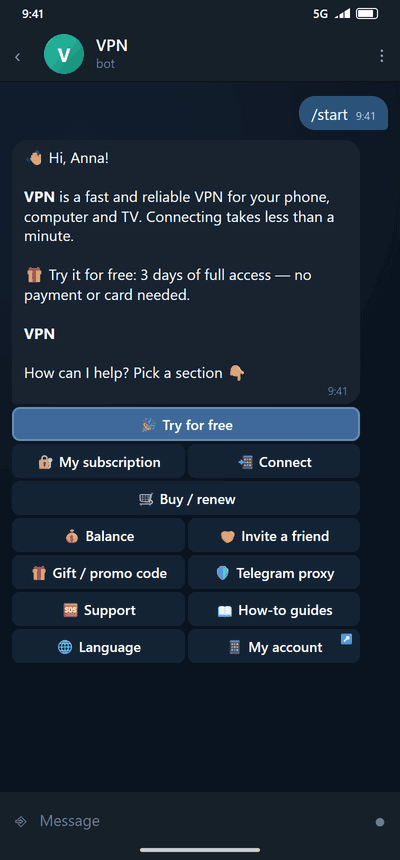
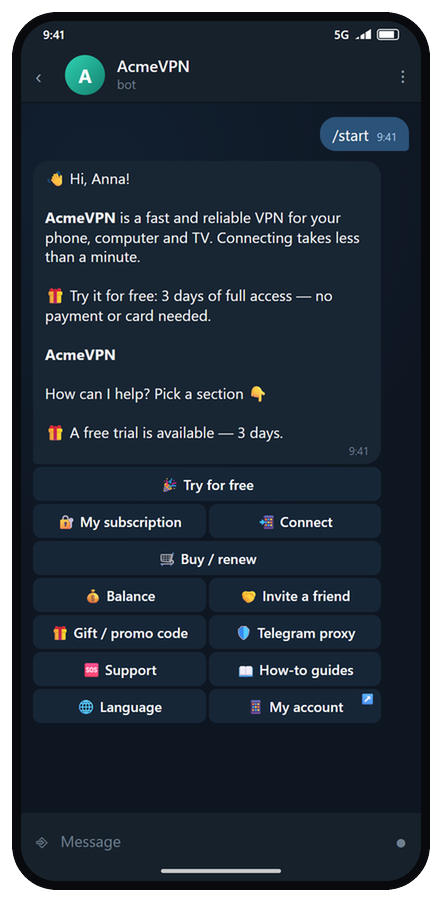
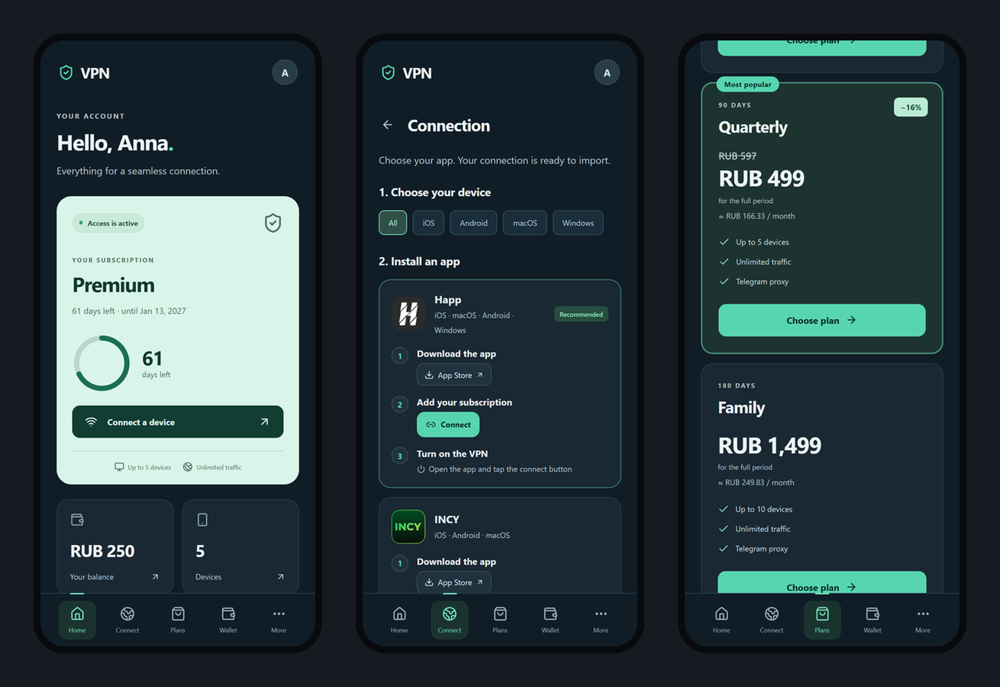
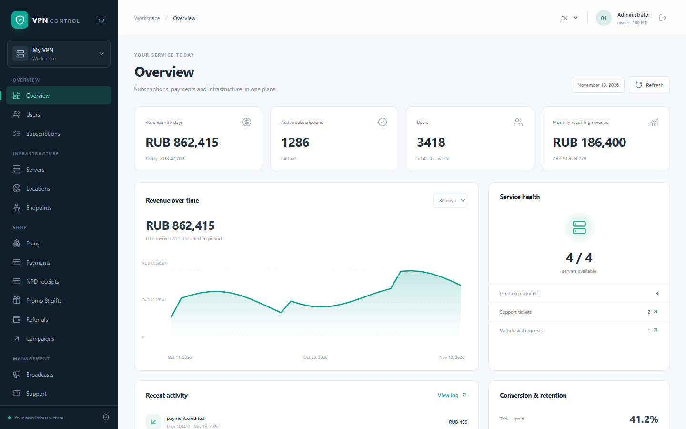
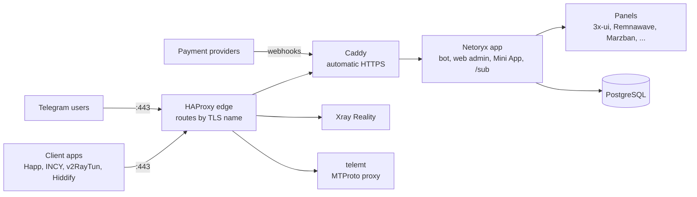

<p align="center">
  <picture>
    <source media="(prefers-color-scheme: dark)" srcset="docs/images/logo-on-dark.png">
    <source media="(prefers-color-scheme: light)" srcset="docs/images/logo-on-light.png">
    
  </picture>
</p>

<p align="center"><b>Your own VPN service in a Telegram bot.</b><br>Self-hosted · 6 panels · 28 payment methods · reliable on restrictive networks</p>

<p align="center">
  <a href="https://github.com/qklafk/netoryx/releases"></a>
  <a href="LICENSE"></a>
  <a href="https://github.com/qklafk/netoryx/actions/workflows/ci.yml"></a>
  <a href="https://github.com/qklafk/netoryx/pkgs/container/netoryx"></a>
  <a href="https://github.com/qklafk/netoryx/stargazers"></a>
</p>

<p align="center">
  <b>English</b> | <a href="README.ru.md">Русский</a>
</p>

<p align="center">
  <a href="#quick-start">Quick start</a> ·
  <a href="#documentation">Docs</a> ·
  <a href="https://t.me/netoryx">Telegram channel</a> ·
  <a href="https://qklafk.github.io/netoryx/">Website</a>
</p>

<!-- demo (enable when the file is added): <p align="center"></p> -->

**Netoryx** is a self-hosted Telegram bot, web admin and Mini App for selling or sharing VPN access.

- **Works with the panels you already run:** 3x-ui, Remnawave, Marzban, Marzneshin, PasarGuard, Hiddify, any mix of them.
- **Sells for you:** 28 payment methods, plans, trials, auto-renew, referrals, one personal subscription link per customer.
- **One command to install** on a fresh Linux server; also fine for yourself, family and friends (personal mode, no payments).

> **Status: 0.9.0-beta.** The first public beta. It runs in production on a real server, but it has had little field
> time compared with older projects. Back up before upgrading and report anything odd in the issues.

## Quick start

On a fresh server, as root:

```bash
curl -fsSL https://raw.githubusercontent.com/qklafk/netoryx/main/install.sh | sudo bash
```

The installer asks for a bot token (from [@BotFather](https://t.me/BotFather)) and your Telegram ID. Non-interactive:

```bash
sudo bash install.sh --bot-token <token> --admin-id <your telegram id> --domain vpn.example.com --with-xui --yes
```

Without `--domain` it uses `<ip-with-dashes>.sslip.io`, which gets a real HTTPS certificate with no DNS setup (the first
certificate can take a minute or two). Optional flags: `--with-xui` (install a 3x-ui panel next to the bot),
`--with-tgproxy` (Telegram MTProto proxy), `--with-socks` / `--socks-port 2080` (Telegram SOCKS5).

**What you get at the end:**

- a one-time link to the web admin;
- the bot's username and your subscription domain;
- if enabled, your own Telegram proxy links with a QR code in the terminal;
- everything in `/opt/netoryx`, managed by the `netoryx` command:
  `netoryx status | logs [service] | update | backup | admin-link | restart | uninstall`.

| System | x86_64 | ARM64 | Status |
|---|---|---|---|
| Ubuntu 24.04 | yes | yes | tested on a real server |
| Ubuntu 22.04, 26.04 | yes | yes | beta |
| Debian 12, 13 | yes | yes | beta |
| AlmaLinux 9, Rocky Linux 9 | yes | yes | beta |

Minimum: root access, 2 vCPU / 2 GB RAM / 20 GB disk, a bot token, ports 80 and 443 open (one more only if you enable
SOCKS5). A domain is recommended; without one `sslip.io` is used. Details, flags and what the installer changes:
[docs/installation.md](docs/installation.md).

## Features

<table>
<tr>
<td width="33%" valign="top">

**🧩 Panels**<br>
3x-ui (2.x and 3.x), Remnawave 3.0+, Marzban, Marzneshin, PasarGuard, Hiddify, any number at once. Import of existing
users, health alerts. [Docs](docs/panels.md)

</td>
<td width="33%" valign="top">

**💳 Payments, 28 methods**<br>
Stars, 6 crypto (CryptoBot, Heleket, NOWPayments, Plisio, direct TON, direct USDT TRC-20), 17 Russian gateways (incl. RollyPay, cisPay, TabPay),
Stripe, PayPal, manual card/SBP, custom HTTP. Credited exactly once. [Docs](docs/payments.md)

</td>
<td width="33%" valign="top">

**📱 Subscriptions and devices**<br>
Several subscriptions per user, bot-side HWID device limit, add-ons, trials, gifts, promo codes, 3-mode referrals,
auto-renew.

</td>
</tr>
<tr>
<td valign="top">

**✈️ Telegram proxies**<br>
A personal MTProto proxy (telemt or 3x-ui) and a personal SOCKS5 account per user, with access rules.
[Docs](docs/telegram-proxy.md)

</td>
<td valign="top">

**🔒 Privacy**<br>
No customer IPs in logs or the database by default, HWIDs stored only as a keyed hash, Xray access log off.
[Docs](docs/privacy.md)

</td>
<td valign="top">

**🖥 Admin, Mini App, cabinet**<br>
React web admin with roles, Telegram Mini App, and a customer cabinet in a plain browser for when Telegram is
unavailable. [Docs](docs/web-cabinet.md)

</td>
</tr>
<tr>
<td valign="top">

**🛡 Connection stability**<br>
Everything on port 443 behind an SNI router, self-hosted Reality server name, compact TLS hello, "LTE" relay endpoints
for mobile networks with restricted access.

</td>
<td valign="top">

**🚫 Ad blocking and YouTube exit**<br>
Optional ad and tracker blocking in the Xray routing of 3x-ui panels, and an optional separate exit server for YouTube.

</td>
<td valign="top">

**🌍 7 languages**<br>
Russian, English, Ukrainian, Kazakh, Uzbek, Persian, Chinese. Only Russian and English are reviewed by native
speakers so far.

</td>
</tr>
</table>

More: multi-level referrals with withdrawals, win-back discounts, tariff audience rules, broadcasts with segments,
tickets, text overrides (white-label), main-menu editor, audit log, encrypted backups, outgoing webhooks
([docs/webhooks.md](docs/webhooks.md)), public API keys, "Мой налог" receipts for the self-employed.

## Screenshots

<!-- screenshots (enable when the files are added):
<table>
<tr><th>Bot</th><th>Mini App</th><th>Web admin</th></tr>
<tr>
<td></td>
<td></td>
<td></td>
</tr>
</table>
-->

Screenshots are coming with the beta.

## How it works



## FAQ

<details>
<summary>Can I sell VPN subscriptions with it? What does the AGPL require?</summary>

Yes, with no royalties or fees. The AGPL only asks for something if you modify the code and let users use that modified
version over a network: then you must offer them its source under the same license. Changing settings, plans, prices,
texts, languages and branding in the admin does not count, those live in the database and `.env`. Not legal advice; see
[License](#license).

</details>

<details>
<summary>What server do I need and what does it cost?</summary>

A small VPS is enough to start: 2 vCPU, 2 GB RAM, 20 GB disk, Ubuntu 24.04 (the tested system). Prices vary by
provider; the VPN traffic itself usually needs more bandwidth than CPU. Put the VPN node in a country that suits your
customers; see [docs/installation.md](docs/installation.md) for the control-plane and VPN-node roles.

</details>

<details>
<summary>What about mobile networks that only allow connections to approved hosts?</summary>

Foreign IPs are often not reachable there. Netoryx supports relay endpoints and a separate "LTE" profile, which you can point
at a relay server inside the country. It cannot guarantee access, since that depends on what the operator allows. See
[docs/panels.md](docs/panels.md).

</details>

<details>
<summary>Can it remove YouTube ads?</summary>

Ad and tracker blocking (`ADBLOCK_ENABLED`) covers many ad domains but not YouTube's own in-video ads. An optional
"YouTube exit" (`YOUTUBE_EXIT_ENABLED`) routes YouTube through a separate server in another country. Both apply to
3x-ui panels and are off by default.

</details>

<details>
<summary>Is it stable?</summary>

It is a beta: the code is covered by several thousand offline tests and integration tests against real panels, and it
runs on a real server, but it has little time in the field. Take a backup before every upgrade.

</details>

## Documentation

| Topic | Pages |
|---|---|
| Getting started | [Beginner's guide](docs/beginners.md), [Installation](docs/installation.md), [Configuration](docs/configuration.md), [Subscription formats](docs/subscriptions.md), [FAQ](docs/faq.md), [Troubleshooting](docs/troubleshooting.md) |
| Operating | [Upgrading](docs/upgrading.md), [Backups](docs/backups.md), [Privacy](docs/privacy.md) |
| Integrations | [Panels](docs/panels.md), [Payments](docs/payments.md), [Outgoing webhooks](docs/webhooks.md) |
| Customers | [Telegram proxy](docs/telegram-proxy.md), [Web cabinet](docs/web-cabinet.md), ["Мой налог" receipts](docs/npd-receipts.md) |
| Russian | [FAQ and quick start](docs/ru/faq.md), [Troubleshooting](docs/ru/troubleshooting.md), [Subscription formats](docs/ru/subscriptions.md), [Telegram proxy](docs/ru/telegram-proxy.md), [Web cabinet](docs/ru/web-cabinet.md), [Receipts](docs/ru/npd-receipts.md) |
| Project | [Contributing](CONTRIBUTING.md), [Security policy](SECURITY.md), [Legal notice](LEGAL.md), [Terms and privacy templates](docs/legal/privacy-policy-template.md), [Changelog](CHANGELOG.md) |

## Legal

Netoryx is software only: the authors run no VPN service, collect no data and the code has no telemetry. Whoever installs
it is the operator and is responsible for complying with the laws that apply to their service and customers. See
[LEGAL.md](LEGAL.md); templates for your terms of service and privacy policy are in [docs/legal](docs/legal/).

## Upgrading

```bash
sudo netoryx backup
sudo netoryx update
```

`netoryx update` fetches the new release and rebuilds only the application container, so active VPN sessions are not
interrupted. Read [docs/upgrading.md](docs/upgrading.md) and the changelog first.

## Support the project

If Netoryx saves you time, the best help is a star on GitHub, a bug report or a pull request. More ways to support the
project will be listed here later.

## Star history

<a href="https://github.com/qklafk/netoryx/stargazers">
  
</a>

## License

Netoryx is licensed under the **GNU AGPL-3.0-or-later** (see [LICENSE](LICENSE)). In plain language, and not legal
advice:

- You may use it, run it and **sell VPN subscriptions with it for free**. There are no royalties and no fees.
- If you **modify the code** and let users interact with your modified version over a network, you must offer those
  users the source of your modified version under the same license.
- Running it unmodified, or only changing settings, texts, plans, prices, languages and branding in the admin, does not
  oblige you to publish anything: those live in the database and the `.env`, not in the code.
- Forking is fine; keep the license and the copyright notices.

Bugs and questions: GitHub Issues. Security problems: see [SECURITY.md](SECURITY.md), please do not open a public issue.
Pull requests are welcome, see [CONTRIBUTING.md](CONTRIBUTING.md).
